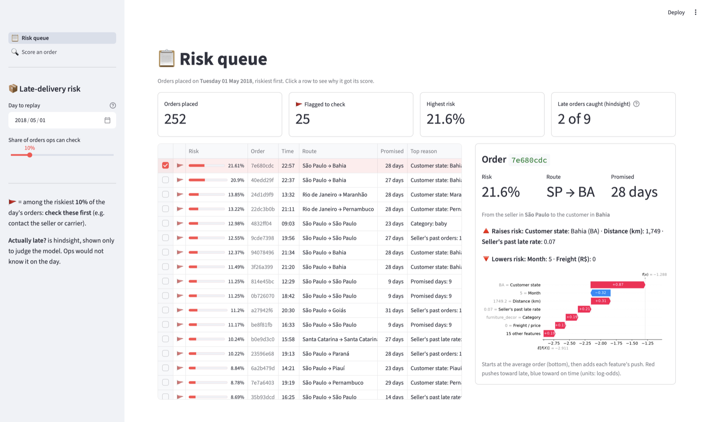
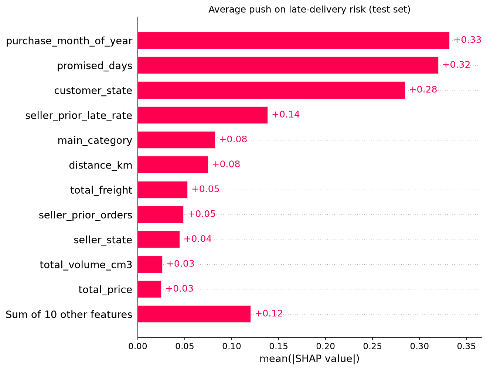

# Olist Late-Delivery Risk

Measuring what late deliveries cost a Brazilian marketplace, and flagging
risky orders at checkout so operations can act before the parcel is late.

## Problem

Olist's operations team sees many 1-star reviews but cannot tell what drives
them: a poor product, or a parcel that arrived after the promised date. They
also cannot see which orders are heading for a late delivery until it has
already happened, even though late deliveries cluster in certain periods
(Nov 2017, Feb–Mar 2018). This project asks two questions:

1. **Measurement:** how much does late delivery hurt review scores and repeat
   purchases? (Uses everything known after the order is complete.)
2. **Prediction:** can an order's late-delivery risk be scored *at the moment
   it is placed*, with reasons, so ops knows which orders to check first?
   (Uses only information available at purchase time.)

## Results at a glance

- **Late orders get 2 stars fewer:** 2.27 vs 4.29 on average. Counting only
  reviews written after the parcel arrived, the gap is still −0.77 stars
  (95% CI −0.84 to −0.69).
- **Repeat purchase: inconclusive.** Only 2% of customers buy again within
  180 days, too few to detect a small effect of lateness.
- **Flagging at checkout:** on the held-out months (May–Aug 2018), checking
  the riskiest 10% of orders catches 26% of late orders, vs 11% for random
  checks.
- **But a simple lookup table does about as well:** across five test windows,
  LightGBM ranks orders 1.64× better than random on average, and a
  customer-state × promised-days table 1.65×. Both are reported below.
- **Usable by ops:** a FastAPI prediction service and a Streamlit dashboard
  that replays a past day, ranks its orders by risk and shows why each one
  was flagged.



## Data

[Olist Brazilian E-commerce Public Dataset](https://www.kaggle.com/datasets/olistbr/brazilian-ecommerce):
about 100k orders from 2016 to 2018, made public by Olist, a Brazilian
marketplace platform. It comes as 9 CSVs, loaded into PostgreSQL 16 (Docker)
and checked with [`sql/00_sanity_checks.sql`](sql/00_sanity_checks.sql).

<details>
<summary>Tables</summary>

| Table | Rows | One row per |
| ----- | ---: | ----------- |
| `orders` | 99,441 | order |
| `order_items` | 112,650 | item within an order |
| `order_payments` | 103,886 | payment within an order |
| `order_reviews` | 99,224 | review of an order |
| `customers` | 99,441 | order's customer record (see note) |
| `products` | 32,951 | product |
| `sellers` | 3,095 | seller |
| `geolocation` | 1,000,163 | zip prefix / coordinate pair (several per zip) |
| `product_category_translation` | 71 | category (Portuguese → English) |

</details>

Data decisions ([notebook 01](notebooks/01_data_overview.ipynb)):

- **Real customers:** `customer_id` is a new value for every order; the real
  customer is `customer_unique_id`. Repeat-purchase analysis depends on it.
- **Scope:** the 96,470 orders that are `delivered` and have a delivery date
  (97% of orders).
- **Period:** purchases from Jan 2017 to Aug 2018. 2016 is too sparse, and
  Sep–Oct 2018 has no delivered orders.
- **Out-of-order middle dates:** 1,373 delivered orders have approval or
  carrier dates out of order. They are kept, because purchase and delivery
  dates are always valid, so their late label is correct.

## Findings

Late vs. on-time orders are compared with 95% confidence intervals and a
regression that adjusts for customer state and purchase month. Late is
defined once, in [`sql/01_order_delivery.sql`](sql/01_order_delivery.sql):
delivered on a later date than the estimated date.

**How often orders are late** ([02](notebooks/02_delivery_lateness.ipynb))

- 6.8% of delivered orders arrive late. A typical order arrives 12 days
  before its estimate, so Olist's estimates are generous.
- Lateness comes in bursts: Nov 2017, Feb 2018 and Mar 2018 hold 48% of all
  late orders.
- The late rate varies by customer state, from 2.8% (AM) to 21.4% (AL).

**Lateness and review scores** ([03](notebooks/03_lateness_vs_reviews.ipynb))

- Late orders average **2.27 stars vs 4.29** for on-time orders, a gap of
  **−2.02 stars**. Comparing orders from the same state and month, the gap is
  still −1.96 (95% CI −2.00 to −1.92).
- 53.8% of late orders get 1 star, vs 6.6% of on-time orders.
- Most of the gap comes from reviews written while customers were still
  waiting. Counting only reviews written after arrival, the gap is
  **−0.77 stars** (95% CI −0.84 to −0.69).

**Lateness and repeat purchase** ([04](notebooks/04_lateness_vs_repeat.ipynb))

- Only 2.0% of customers buy again within 180 days.
- Customers whose first order was late came back at 1.58% vs 2.01%
  (−0.43 percentage points). Within the same state and month the gap is
  −0.26 points (95% CI −0.69 to +0.16), which includes zero.
- **Inconclusive:** repeat purchase is too rare in this data to detect a
  small effect. The case for a late-delivery model therefore rests on
  review scores.

## Model

**Target:** `is_late`, the same definition as above (6.6% of training
orders).

**Features: only what is known at purchase time** ([`sql/03_order_features.sql`](sql/03_order_features.sql),
[notebook 05](notebooks/05_features.ipynb)). 21 features: promised delivery
days, seller–customer distance, customer and seller state, basket (items,
price, freight, weight, volume, category), payment type and installments,
purchase month/day/hour, and the seller's history.

- **Leakage control:** the seller's past late rate counts only that seller's
  orders already delivered *before* this purchase. A brute-force recount on
  500 random orders matched exactly.
- Post-purchase columns (approval, carrier and delivery dates, shipping
  deadline, reviews) are never used.

**Validation: split by time, never at random** ([`src/train.py`](src/train.py)).
The model must score future orders, and lateness comes in bursts, so a
random split would let it learn from the future.

| Part | Purchases | Orders | Late |
| ---- | --------- | -----: | ---: |
| Train | Jan 2017 – Feb 2018 | 57,050 | 6.6% |
| Validation (early stopping) | Mar – Apr 2018 | 13,801 | 11.8% |
| Test (used once) | May – Aug 2018 | 25,352 | 4.4% |

**Metrics:** average precision (AP), because only ~7% of orders are late and
accuracy would reward predicting "on time" for everything. A random ranking
scores AP ≈ the late rate. Also: precision and recall when ops checks the
riskiest 10% of orders.

**Baselines:** random scores, logistic regression, and three rules ops could
follow without a model, built from the model's top reasons. Each rule's late
rates are learned from the training months only.

**Test set (May–Aug 2018):**

| Method | AP | Recall, top 10% | Precision, top 10% |
| ------ | -: | --------------: | -----------------: |
| Random | 0.046 | 11.1% | 4.9% |
| Rule: riskiest customer state | 0.048 | 11.7% | 5.1% |
| Rule: state × promised-days table | 0.064 | 17.7% | 7.8% |
| Logistic regression | 0.074 | 19.7% | 8.7% |
| LightGBM | 0.094 | 25.7% | 11.3% |
| Rule: shortest promised delivery time | 0.099 | 29.1% | 12.8% |

**Backtest across five windows.** One test window can mislead, so every
method is retrained and scored on five consecutive windows (AP ÷ late rate,
so 1.0 = random):

| Method | Sep–Oct 17 | Nov–Dec 17 | Jan–Feb 18 | Mar–Apr 18 | May–Aug 18 | Mean |
| ------ | ---------: | ---------: | ---------: | ---------: | ---------: | ---: |
| LightGBM | 1.74 | 1.27 | 1.47 | 1.61 | 2.14 | 1.64 |
| Rule: state × promised-days table | 1.65 | 1.45 | 1.64 | 2.05 | 1.46 | 1.65 |
| Rule: riskiest customer state | 1.85 | 1.41 | 1.47 | 1.55 | 1.10 | 1.48 |
| Rule: shortest promised delivery time | 1.12 | 0.92 | 0.99 | 0.92 | 2.26 | 1.24 |

The shortest-promise rule tops the May–Aug test but is no better than
random in three earlier windows, which shows why a single test window is
not enough.

**Why keep LightGBM?** Across five test windows it ranks orders about as well
as a simple state × promised-days lookup table (mean 1.64× vs 1.65× better
than random), not clearly better. It is kept because it can use many
features at once (seller history, distance, basket) and gives per-order
reasons, and it may improve more than a fixed table as data grows. That last
point is a hypothesis: in this backtest, its lead over the table did not
grow steadily with training size.

**Explaining scores with SHAP** ([notebook 06](notebooks/06_model_explain.ipynb)):
each order's score is split into per-feature pushes toward late or on time.
The dashboard shows these as the order's "top reason" and waterfall chart.



**How ops would use it:** each day, check the riskiest 10% of new orders
first (for example, contact the seller or carrier). The share is a slider in
the dashboard.

**Serving:** a FastAPI service ([`app/api.py`](app/api.py)) takes an order's
purchase-time details and returns its risk score, with input checks. The
Streamlit dashboard ([`app/dashboard.py`](app/dashboard.py)) loads the same
model through [`src/predict.py`](src/predict.py), so both score orders the
same way. Both are covered by pytest tests.

## Limitations

- **Associations, not proof of cause.** The review and repeat-purchase gaps
  adjust for state and month, but not for product, seller or price. So this
  project cannot fully separate "bad product" from "late parcel" as the
  reason for a bad review.
- **Why lateness comes in bursts is not explained.** The data has no
  carrier, warehouse or weather information, so the cause of the Nov 2017 and
  Feb–Mar 2018 spikes cannot be tested here.
- **Month feature kept, but uncertain.** `purchase_month_of_year` is the top
  SHAP feature, but the data covers only 20 months, so each calendar month
  appears once or twice. In the backtest, the model without it scored higher
  in 4 of 5 windows. It was kept so the deployed model stays unchanged;
  dropping it is the first thing to test with more data.
- **Early stopping is fragile.** The validation months are a lateness burst
  (11.8% late vs 6.6% in train), and the number of trees picked ranges from
  15 to 111 across backtest windows.
- **Each result is a single run** with one random seed; differences of about
  0.1 in the backtest table may be noise.
- **Scores run slightly high:** on test orders the model predicts 5.7% late
  on average vs 4.4% actual, so a score is a ranking first and a probability
  second.
- **Excluded orders:** most of the 1,107 `shipped` orders are old and were
  likely never delivered. They are excluded, so measured lateness is slightly
  optimistic.

## How to run

Requirements: [uv](https://docs.astral.sh/uv/), Docker Desktop, and a
[Kaggle API token](https://www.kaggle.com/docs/api).

```bash
# 1. Install dependencies
uv sync

# 2. Configure credentials (then edit .env and set a password)
cp .env.example .env

# 3. Start PostgreSQL 16
docker compose up -d

# 4. Download the dataset into data/raw/
uv run python src/download_data.py

# 5. Load the CSVs into Postgres
uv run python src/load_to_postgres.py

# 6. Verify the load
docker exec -i olist-postgres sh -c 'psql -U "$POSTGRES_USER" -d "$POSTGRES_DB"' < sql/00_sanity_checks.sql

# 7. Create the analysis views (re-run after every load)
docker exec -i olist-postgres sh -c 'psql -U "$POSTGRES_USER" -d "$POSTGRES_DB"' < sql/01_order_delivery.sql
docker exec -i olist-postgres sh -c 'psql -U "$POSTGRES_USER" -d "$POSTGRES_DB"' < sql/02_order_outcomes.sql
docker exec -i olist-postgres sh -c 'psql -U "$POSTGRES_USER" -d "$POSTGRES_DB"' < sql/03_order_features.sql

# 8. Open the notebooks in notebooks/ (in order) with the project's .venv kernel

# 9. Train and evaluate (baselines, LightGBM, backtest);
#    saves models/late_risk_lgbm.joblib for notebook 06, the API and the dashboard
uv run python src/train.py

# 10. Run the tests (no database needed, only the saved model)
uv run pytest

# 11. Start the prediction API, then open http://localhost:8000/docs
uv run uvicorn app.api:app --reload

# 12. Start the dashboard (needs the database running)
uv run streamlit run app/dashboard.py
```

On macOS, LightGBM needs OpenMP: `brew install libomp`.

## Project structure

```
data/raw/          Kaggle CSVs as downloaded (git-ignored)
data/processed/    Derived tables and feature sets (git-ignored)
notebooks/         Numbered notebooks, one question each
sql/               Numbered SQL files: delivery, outcomes, features
src/               Reusable Python: download, load, features, training, scoring
models/            Trained model saved by src/train.py (git-ignored)
app/               FastAPI service and Streamlit dashboard
tests/             pytest tests
reports/figures/   Figures used in this README
```
